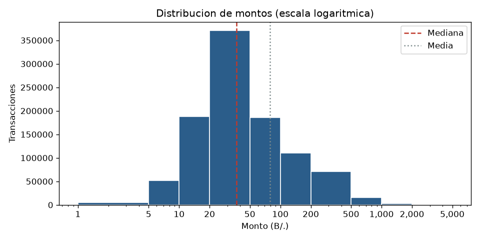
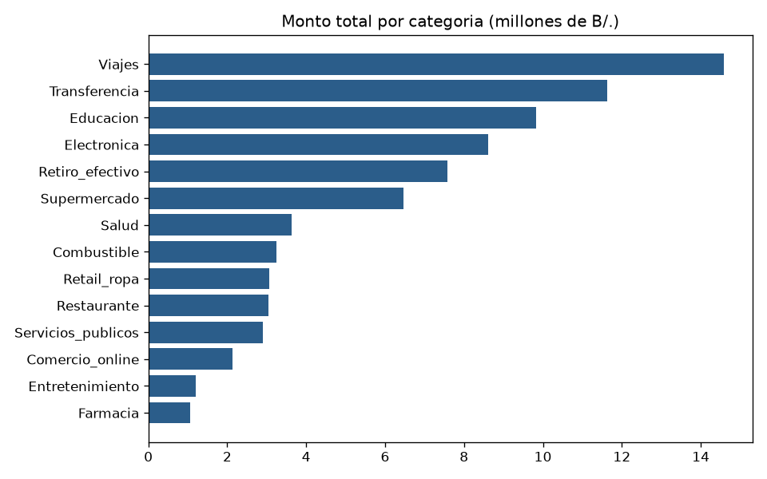
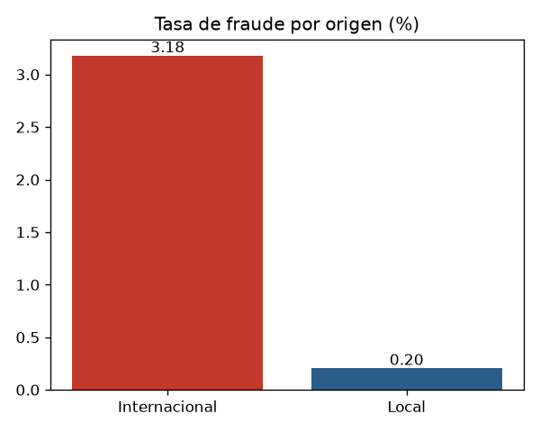
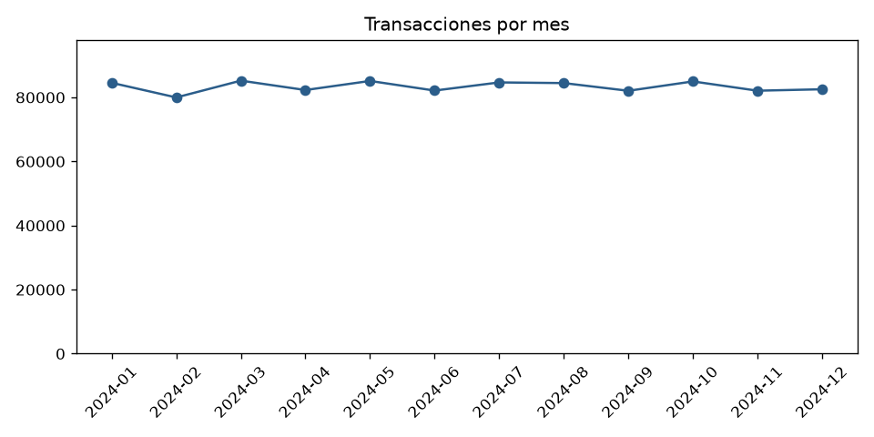

# Analisis exploratorio de datos (EDA)

Script: `scripts/eda.py` · Datos: `data/transactions.csv`

## 1. Registros y columnas

- Registros: 1,000,000
- Clientes unicos: 40,000
- Periodo: 2024-01-01 a 2024-12-30

| columna | tipo | nulos | valores_distintos |
|---|---|---|---|
| transaction_id | str | 0 | 1,000,000 |
| customer_id | str | 0 | 40,000 |
| customer_name | str | 0 | 504 |
| customer_age | int64 | 0 | 62 |
| customer_gender | str | 0 | 2 |
| province | str | 0 | 10 |
| account_type | str | 0 | 4 |
| transaction_date | str | 0 | 365 |
| transaction_time | str | 0 | 86,400 |
| channel | str | 0 | 5 |
| merchant_category | str | 0 | 14 |
| card_type | str | 0 | 3 |
| amount | float64 | 0 | 60,002 |
| currency | str | 0 | 1 |
| is_international | int64 | 0 | 2 |
| status | str | 0 | 3 |
| is_fraud | int64 | 0 | 2 |

Valores nulos en total: 0.

## 2. Distribucion de los montos

| estadistico | monto |
|---|---|
| Conteo | 1,000,000 |
| Minimo | 1.00 |
| Percentil 25 | 20.30 |
| Mediana | 36.96 |
| Media | 78.97 |
| Percentil 75 | 79.51 |
| Percentil 95 | 296.27 |
| Maximo | 4,392.81 |
| Desviacion estandar | 127.99 |

## 3. Frecuencia por categoria y canal

| merchant_category | transacciones | porcentaje | monto_total |
|---|---|---|---|
| Supermercado | 180,089 | 18.01 | 6,462,201.61 |
| Restaurante | 139,692 | 13.97 | 3,040,891.42 |
| Combustible | 100,026 | 10.00 | 3,247,204.61 |
| Transferencia | 79,751 | 7.98 | 11,636,985.68 |
| Retiro_efectivo | 70,376 | 7.04 | 7,582,394.22 |
| Retail_ropa | 69,765 | 6.98 | 3,056,203.36 |
| Servicios_publicos | 60,024 | 6.00 | 2,900,960.36 |
| Farmacia | 59,970 | 6.00 | 1,066,711.49 |
| Entretenimiento | 50,210 | 5.02 | 1,205,976.65 |
| Salud | 50,067 | 5.01 | 3,622,165.50 |
| Electronica | 39,875 | 3.99 | 8,605,051.00 |
| Comercio_online | 39,872 | 3.99 | 2,137,626.68 |
| Educacion | 30,158 | 3.02 | 9,825,932.73 |
| Viajes | 30,125 | 3.01 | 14,584,353.55 |

| channel | transacciones | porcentaje | monto_total |
|---|---|---|---|
| POS | 340,798 | 34.08 | 26,934,216.66 |
| App_movil | 259,515 | 25.95 | 20,500,849.32 |
| ATM | 219,907 | 21.99 | 17,381,452.82 |
| Banca_en_linea | 139,713 | 13.97 | 11,031,469.17 |
| Sucursal | 40,067 | 4.01 | 3,126,670.89 |

| province | transacciones | porcentaje | monto_total |
|---|---|---|---|
| Panama | 418,674 | 41.87 | 33,086,005.02 |
| Panama Oeste | 159,722 | 15.97 | 12,618,592.99 |
| Chiriqui | 110,076 | 11.01 | 8,728,082.68 |
| Colon | 80,799 | 8.08 | 6,361,473.99 |
| Cocle | 61,289 | 6.13 | 4,823,353.58 |
| Veraguas | 60,155 | 6.02 | 4,775,228.02 |
| Herrera | 38,813 | 3.88 | 3,048,710.32 |
| Los Santos | 30,051 | 3.01 | 2,331,277.24 |
| Darien | 21,213 | 2.12 | 1,704,604.36 |
| Bocas del Toro | 19,208 | 1.92 | 1,497,330.66 |

## 4. Fraude (is_fraud)

- Transacciones marcadas como fraude: 3,813 (0.381 %)
- Internacionales: 3.18 % · Locales: 0.20 %
- Montos mayores a B/. 3,000: 5.56 %

## 5. Tendencia por mes

## 6. Hallazgos

1. La media (78.97) es el doble de la mediana (36.96): hay muchos montos pequenos y pocos muy altos. El 5 % de las transacciones mas grandes concentra el 32.7 % del dinero.
2. Las transacciones internacionales tienen 3.18 % de fraude frente a 0.20 % de las locales, unas 16 veces mas.
3. Solo el 0.381 % de las transacciones es fraude, asi que las clases estan muy desbalanceadas.
4. Viajes tiene el 3.0 % de las transacciones pero el 18.5 % del dinero.
5. El volumen por mes varia solo 6.3 %, no hay una tendencia fuerte en el tiempo.
